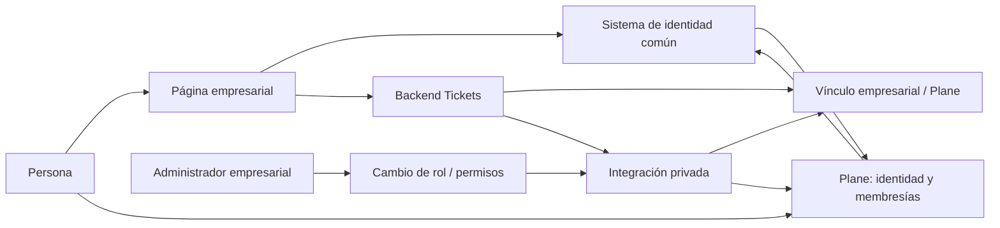
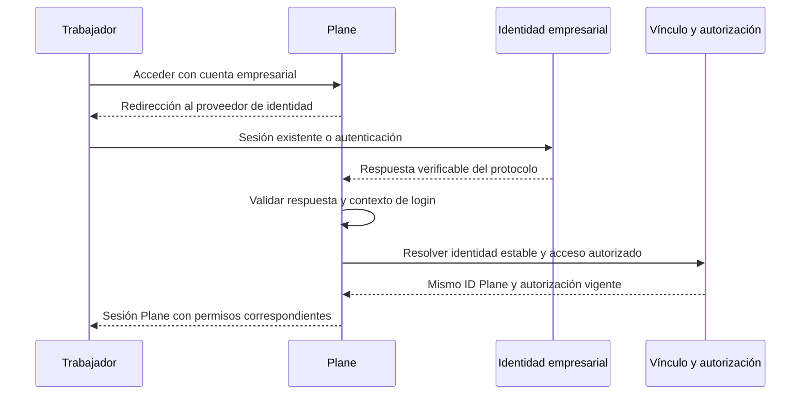

# Plan de identidad empresarial y acceso compartido a Plane

Fecha: 23 octubre 2026. **Diseño pendiente de implementación.** Este documento recoge el cambio acordado en la conversación; no afirma que exista actualmente SSO, sincronización de roles ni integración con la página empresarial.

El funcionamiento implementado está en [PROJECT_CONTEXT.md](PROJECT_CONTEXT.md). Esta tarea solo consolida documentación: no modifica código, configuración, datos ni despliegues.

## 1. Objetivo explicado de forma sencilla

Una persona se registra una sola vez en la página de la empresa. Como usuario normal puede enviar tickets desde esa página. Al enviar el primero se crea su identidad en Plane, sin contraseña local utilizable. Si después un administrador la convierte en trabajador autorizado, se habilita su acceso de gestión usando **la misma cuenta de Plane**, con los proyectos que le correspondan.

El trabajador entra mediante «Acceder con la cuenta empresarial». Plane verifica su identidad con el sistema de acceso común; no recibe ni compara la contraseña empresarial. La identidad puede seguir sin contraseña local de Plane.

Ejemplo: Pedro registra su cuenta empresarial, envía SUP-12 y luego pasa a trabajador. Pedro mantiene su ID de Plane y SUP-12 conserva su autor. Solo cambian el acceso y los permisos. Si Pedro pasa a trabajador antes de enviar cualquier ticket, el proceso de habilitación crea y vincula su identidad Plane una única vez.

## 2. Lo actual frente a lo previsto

| Área | Actualmente | Diseño previsto |
|---|---|---|
| Registro/login Tickets | Propios del portal, SQLite y scrypt | Usar identidad empresarial; sin segundo registro obligatorio |
| Identificador | UUID del portal y username `tickets_<UUID>` | Vínculo durable entre identidad empresarial y el mismo ID Plane |
| Primer envío | Crea identidad Plane y membresías | Conserva creación diferida para reportantes, con política mínima de permisos |
| Contraseña Plane del reportante | `set_unusable_password()` | Puede mantenerse inutilizable; no copiar contraseñas ni hashes |
| Rol trabajador | No se recibe ni sincroniza | Cambio administrativo sincroniza acceso y proyectos |
| Login Plane empresarial | No implementado | Federación de identidad compatible, pendiente de verificar |
| Cuenta Plane ya existente | Conflicto si no coincide con vínculo interno | Vinculación verificada y auditable; no apropiación por coincidencia de correo |
| Baja de trabajador | Sin mecanismo empresarial | Revocación de acceso de gestión conservando identidad y autoría |

## 3. Responsabilidades y fuentes de verdad

La **aplicación empresarial** determina el usuario, su estado y sus autorizaciones de negocio. El **proveedor de identidad** autentica a la persona. Puede ser parte del sistema empresarial si tiene las capacidades necesarias, o un proveedor común al que se conecten tanto la página como Plane.

El **backend Tickets** valida la sesión empresarial y autoriza el envío. El **servicio privado de integración** mantiene el vínculo y aplica altas/cambios de permisos. **Plane** conserva sus usuarios, sesiones, membresías y tickets; verifica la identidad federada y aplica permisos de sus recursos.

No compartir directamente tablas de contraseñas entre aplicaciones. No enviar la contraseña al bridge, a Plane ni al navegador como mecanismo de integración. No confiar en un `user_id`, correo o rol enviado libremente desde el formulario.

El diagrama expresa responsabilidades propuestas, no servicios Docker ya creados. El proveedor, protocolo y ubicación del almacén de vínculos quedan por decidir tras inspeccionar los sistemas reales.

## 4. Flujo: registro y primer ticket de usuario normal

1. La persona se registra en el sistema empresarial y completa la política de verificación de identidad/correo que se defina allí.
2. Abre Tickets con su sesión empresarial. El backend verifica la sesión mediante un contrato soportado, no por leer ciegamente una cookie de otra aplicación.
3. El servidor obtiene ID estable, nombre, correo, estado y permisos. Comprueba que puede reportar al proyecto elegido.
4. Al pulsar **Enviar ticket**, consulta el vínculo de identidad. Si no existe identidad Plane, la crea de forma idempotente con contraseña inutilizable y los permisos mínimos necesarios para atribuir el ticket.
5. Guarda el vínculo y crea el work item bajo esa identidad, conservando las garantías de idempotencia y autoría.
6. Devuelve el identificador del ticket al módulo empresarial. El usuario no necesita abrir Plane.

La contraseña inutilizable solo bloquea autenticación por contraseña. **No constituye una política de prohibición de SSO, recuperación de contraseña u otros métodos.** El usuario normal debe carecer explícitamente de autorización para entrar a la interfaz de gestión por cualquiera de los métodos habilitados.

La consulta del estado/historial de solicitudes en la página empresarial requerirá diseñar rutas y permisos por propietario si se incorpora; no existe hoy en este portal y no debe confundirse con dar acceso general a Plane.

## 5. Flujo: usuario convertido en trabajador

1. Un administrador autorizado realiza el cambio de rol en el sistema empresarial.
2. Se determina si ese trabajador tiene derecho a usar Plane y qué proyectos/acciones le corresponden. El rol laboral por sí solo no debe implicar acceso global ni God Mode.
3. El backend emite una operación de sincronización autenticada, con identificador de evento y versión del cambio.
4. La integración busca el vínculo por ID empresarial. Reutiliza el usuario Plane existente; si nunca se creó, lo provisiona una sola vez.
5. Aplica los permisos y habilita el acceso federado de esa identidad. Registra el resultado y reintenta si Plane está temporalmente indisponible.
6. El trabajador abre Plane por el acceso empresarial. El login debe resolver hacia ese mismo ID Plane, no crear otro usuario automáticamente.

Ni `created_by` ni los IDs de tickets anteriores se reescriben. Un cambio de nombre puede reflejarse en la presentación del perfil; la referencia de autoría sigue apuntando a la misma identidad.

## 6. Flujo: inicio de sesión compartido

SSO significa que ambas aplicaciones confían en el mismo sistema de identidad. No significa registrar la misma contraseña dos veces.

Este es un flujo conceptual: el detalle de red depende del protocolo y conector elegidos. Con un protocolo basado en códigos, parte del intercambio ocurre entre servidores; no enviar credenciales empresariales a través del navegador hacia Plane.

Antes de implementar, comprobar:

- Tecnología, dominio, mecanismo de sesión y proveedor de identidad de la página empresarial.
- Edición, versión y configuración reales de Plane, incluidas capacidades/licencia de federación y asociación de identidades externas.
- Posibilidad de enlazar la identidad federada a un usuario Plane ya creado por el bridge, conservando su ID.
- Métodos de login existentes, registro automático, recuperación de contraseña y controles de autorización aplicables.

No se da por hecho soporte OIDC/SAML en la edición instalada ni se promete que basta con configurar variables. Si se requiere cambiar de edición, incorporar un proveedor o desarrollar un adaptador, será una decisión explícita después de esa comprobación. No construir un login casero que transmita contraseñas ni un proxy que deje accesos directos alternativos abiertos.

Si SSO no resulta viable, documentar y acordar una alternativa de credencial Plane independiente antes de implementarla. Esa alternativa no satisface por sí sola la experiencia de acceso compartido y también debe conservar la misma identidad Plane.

## 7. Modelo de vínculo propuesto

Esquema conceptual, todavía sin migración ni base elegida:

| Dato | Propósito |
|---|---|
| `enterprise_user_id` | ID permanente de la persona en el sistema empresarial |
| Ámbito de empresa/tenant, si existe | Evitar colisiones entre empresas; el alcance actual es un workspace fijo |
| `identity_issuer` y `identity_subject` | Identidad externa estable del proveedor cuando aplique; no sustituirla por correo |
| `plane_user_id` | ID existente que se debe preservar |
| `legacy_portal_user_id` | Permitir migrar cuentas actuales y su historial de idempotencia |
| Estado de acceso de gestión | Habilitado/revocado/pendiente según política empresarial |
| Versión de permisos y última sincronización | Evitar que un evento viejo deshaga una baja o una restricción reciente |
| Fechas y auditoría de vinculación | Quién autorizó el vínculo y cómo se verificó |

Imponer unicidad en el ámbito correcto y resolver carreras entre primer envío, promoción y primer login. No reemplazar sin más el UUID portal en `external_id`: eso podría romper reintentos antiguos o crear una segunda identidad. El ID empresarial puede no ser UUID; adaptar el contrato y validación deliberadamente.

El correo es un atributo modificable. Ni un cambio de correo ni un cambio de rol deben crear otra cuenta. Si existe una cuenta Plane con el mismo correo sin vínculo verificado, detener la asociación y resolverla mediante prueba de control o revisión administrativa auditada. El autoprovisionamiento del conector SSO debe respetar esta misma regla.

## 8. Política de permisos y revocación

| Persona | Portal empresarial | Plane de gestión |
|---|---|---|
| Usuario normal activo | Envíos autorizados por la política del módulo | Denegado aunque exista identidad Plane para autoría |
| Trabajador con acceso concedido | Conserva las funciones que le correspondan | Solo proyectos y acciones asignados |
| Administrador empresarial | Administración según su rol empresarial | No implica automáticamente InstanceAdmin/God Mode |
| Extrabajador que sigue como usuario | Conserva las funciones normales autorizadas | Acceso de gestión revocado |
| Cuenta empresarial desactivada | Acceso denegado según política global | Acceso y sesiones revocados |

Revisar la necesidad real de Guest/Member para el reportante según el serializer/backend fijado. No prometer un rol «solo reportar» que Plane no ofrezca ni usar el `Member` actual como prueba de condición laboral. Si hacen falta membresías técnicas para autoría, la denegación de login de reportantes debe existir de forma independiente y no poder eludirse por otra ruta.

Una baja debe retirar acceso de gestión y tratar sesiones Plane ya emitidas: bloquear solo el próximo login no revoca una sesión abierta. Definir mecanismo de revocación, plazo máximo aceptable y comportamiento ante fallo del proveedor o sincronización. No borrar usuarios ni tickets para quitar acceso.

La integración gestionará únicamente los permisos que tenga a su cargo. No eliminar administradores de instancia ni sobrescribir membresías manuales sin una política de propiedad explícita. Un envío posterior tampoco debe reactivar permisos retirados por la sincronización.

## 9. Cambios previstos por componente

| Componente | Trabajo posterior |
|---|---|
| Página empresarial, fuera de este repositorio | Integrar módulo y botón de acceso; emitir cambios de autorización desde backend; definir identidad/sesión confiable |
| `nuevo-ticket/public/` | Sustituir registro/login propio en modo integrado por uso de la sesión empresarial; mantener estado de envío y reintentos |
| `lib/portal-auth.js` | Adaptador de autenticación empresarial y validación server-side; mantener protección de mutaciones según el despliegue elegido |
| `lib/portal-store.js` | Migración de cuentas/vínculos; preservar resultados e idempotencia; decidir persistencia compartida si se escala |
| `server.js` | Obtener identidad empresarial validada y aplicar autorización de proyectos; nunca roles del navegador |
| `lib/plane-bridge.js` | Contrato de identidad estable y operaciones privadas necesarias, sin contraseñas |
| `plane-ticket-bridge/bridge.py` | Resolución por vínculo, provisión concurrente, política de membresías y sincronización de permisos sin duplicar usuarios |
| Plane/proveedor de identidad | Conector de login compatible, enlace de cuenta existente, restricciones de acceso y revocación |
| Compose y configuración | Variables/secretos de integración y callbacks que finalmente se definan, sin exponer el bridge |
| Pruebas | Flujos de roles, vinculación, login, migración, concurrencia y revocación |

Editar `plane/` no afecta a las imágenes que ejecuta el Compose raíz. Si el diseño final exige personalizar Plane, habrá que definir y probar una imagen propia o un mecanismo soportado; no asumir que modificar el árbol vendorizado despliega el cambio.

MCP no autentica a los usuarios empresariales ni es necesario para implementar SSO. El flujo de creación actual puede seguir pasando por el bridge; el token de servicio para proyectos/adjuntos es independiente de la identidad humana.

## 10. Consistencia y transición desde las cuentas actuales

1. Inventariar cuentas empresariales, cuentas del portal e identidades Plane en un entorno autorizado, sin volcar secretos a documentación.
2. Respaldar SQLite, PostgreSQL y objetos antes de migrar. Mantener el proyecto Compose y los volúmenes existentes.
3. Añadir el vínculo y migraciones compatibles sin eliminar las cuentas actuales. Resolver asociaciones con evidencia, no por email sin verificar.
4. Ensayar con una persona que ya haya enviado tickets: el nuevo login debe devolver exactamente el mismo `plane_user_id` y los tickets conservar su `created_by`.
5. Activar la integración de forma controlada; definir si el modo standalone seguirá disponible para pruebas o quedará retirado. El login antiguo no debe convertirse en una vía para eludir restricciones empresariales.
6. Reconciliar permisos y sesiones; mantener un procedimiento de rollback que no regenere identidades ni deshaga revocaciones de seguridad.

La sincronización propuesta debe tolerar eventos repetidos y desordenados mediante IDs/versiones. Registrar fallos, reintentar de forma durable y reconciliar periódicamente el estado empresarial con el aplicado. Mientras no se confirme una promoción, no conceder acceso optimista. Una baja pendiente requiere un mecanismo de denegación que cumpla el plazo de revocación definido.

No es necesario convertir la sincronización en otro servicio desde el primer día: puede formar parte de la integración existente si conserva separación de permisos, autenticación privada y trazabilidad. La topología se decidirá al conocer el backend empresarial.

## 11. Fases y criterios de aceptación

1. **Descubrimiento:** confirmar autenticación empresarial, edición Plane, conector y asociación a usuario existente. Entregable: arquitectura concreta compatible, sin promesas de SSO aún no verificadas.
2. **Vínculo:** implementar almacenamiento/migración y resolución idempotente. Probar colisiones de correo, cambio de correo y concurrencia.
3. **Tickets integrado:** validar sesión empresarial y crear con autor correcto; retirar el segundo registro del flujo empresarial.
4. **Permisos:** implementar promoción, proyectos y baja, con eventos reintentables y auditoría.
5. **SSO:** configurar login y vinculación a la cuenta existente; denegar usuarios sin autorización e invalidar accesos retirados.
6. **Transición:** ensayo aislado, restauración comprobada, migración controlada y verificación antes de producción.

La implementación estará completa cuando se compruebe al menos:

- Registrar una cuenta empresarial no crea innecesariamente otra identidad de login en Tickets.
- El primer envío crea una única identidad Plane y autor correcto; reintentos no duplican el work item.
- Un usuario normal no entra a Plane por SSO, contraseña, recuperación u otra ruta configurada, aunque conozca la URL.
- Promover a quien ya envió tickets conserva el mismo ID Plane y la autoría de todos sus tickets.
- Promover a quien nunca envió tickets crea una sola identidad, incluso si ocurre al mismo tiempo que su primer envío o login.
- El trabajador entra con identidad empresarial y solo obtiene los proyectos autorizados.
- Un rol/correo falsificado desde el navegador no cambia identidad ni permisos.
- Un correo coincidente no permite apropiarse de una cuenta preexistente.
- Cambio de correo, eventos repetidos y eventos desordenados no duplican cuentas ni revierten una baja.
- Retirar la autorización impide nuevos accesos y trata las sesiones existentes dentro del plazo acordado, sin borrar tickets.
- Una caída de sincronización se observa y recupera sin conceder permisos indebidos.
- Ninguna contraseña empresarial ni hash se copia a Plane o aparece en logs.

## 12. Decisiones pendientes y alcance

Falta conocer el sistema empresarial real, su ID estable y política de correo, su proveedor/sesiones, la edición exacta de Plane, el soporte de vinculación y revocación, los proyectos por trabajador y quién administra esas asignaciones. También falta decidir dominio/topología del módulo y almacenamiento del vínculo. No se fijan proveedores, protocolos, rutas de callback ni variables ficticias como si ya existieran.

La conversación sobre protección frente a envíos masivos se dejó para después. Sus límites y riesgos actuales están en el contexto único; este plan no convierte sus posibles mejoras en cambios aprobados o implementados. La integración de identidad tampoco elimina por sí misma el riesgo de abuso.

**Invariante central del cambio:** una persona que reportó como usuario y después pasa a trabajador conserva su misma identidad Plane. El rol cambia; la cuenta y la autoría anterior permanecen.
