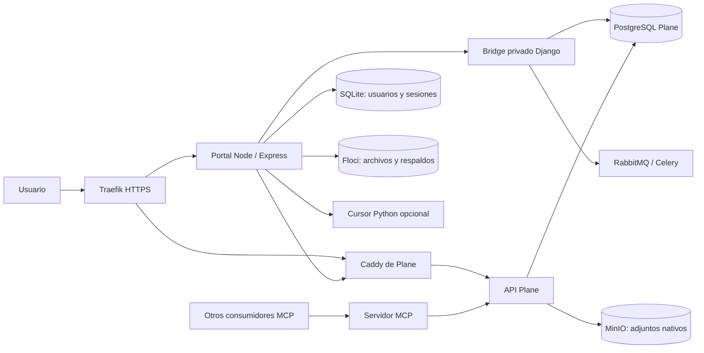

# Contexto único del proyecto actual

Actualizado: 23 octubre 2026. Base de código: `458f107` (`feat(portal): registro propio y autoría real vía plane-ticket-bridge`). Revisión local del repositorio y Docker Desktop. No se consultó el VPS ni se ejecutó el aprovisionador Dokploy.

## 1. Conclusión

El proyecto implementa un portal de recepción de solicitudes con identidad propia, integración transaccional con Plane y dos almacenes de adjuntos. La separación entre registro del portal y creación diferida de identidad Plane está implementada. La protección contra duplicación del work item es razonada y tiene pruebas. El sistema conserva, sin embargo, deuda de operación, recuperación de fallos e identidad que impide equiparar «arranca» con «listo para exposición pública».

Este es el único contexto vigente de la integración. Describe lo implementado, sus operaciones y limitaciones. El diseño futuro está separado en [PLAN_IDENTIDAD_EMPRESARIAL.md](PLAN_IDENTIDAD_EMPRESARIAL.md) y todavía no está implementado. Los resultados históricos no deben interpretarse como comprobaciones actuales.

## 2. Alcance y límites

Inventario Git: **11.635 archivos versionados**, distribuidos en 6.505 de Floci, 5.066 de Plane, 33 del portal, 11 de MCP, 3 del bridge, 6 de pruebas y 11 de raíz. Antes de esta consolidación había **212 Markdown versionados**. Las cifras corresponden al commit base, no al árbol posterior a la limpieza documental.

Se revisaron en detalle los siete Markdown raíz de contexto, los README propios, código runtime del portal y bridge, configuración Compose, Dockerfiles, autenticación, persistencia, frontend y pruebas de integración. Se revisaron también utilidades heredadas, scripts Cursor, estado Git, instrucciones AGENTS y puntos de integración del código vendorizado de Plane/Floci.

**No se afirma una auditoría línea por línea de los 11.571 archivos de Plane y Floci, ni lectura semántica completa de todos sus manuales de servicios AWS.** Su documentación se inventarió completa; la revisión detallada upstream se dirigió a arquitectura, contratos, serialización, identidad y almacenamiento relevantes para esta integración. Tampoco se certifican CVE, compatibilidad de todas las dependencias, restauración de datos ni estado de producción.

Esta consolidación solo modifica documentación propia. No modifica código funcional, configuración, credenciales ni contenedores. Los manuales e instrucciones internos de `plane/` y `floci/` se conservan como documentación upstream, no como otros contextos de esta integración.

## 3. Arquitectura efectiva



El Compose raíz tiene **17 servicios y 12 volúmenes nombrados**. Construye únicamente `nuevo-ticket`, `plane-mcp-server` y `plane-ticket-bridge`. Plane y Floci se ejecutan mediante imágenes fijadas por digest; editar sus carpetas fuente no cambia esas imágenes.

| Componente | Función real |
|---|---|
| `nuevo-ticket/server.js` | HTTP, sesiones, recepción multipart, validación de proyectos, coordinación del envío y respaldos |
| `lib/portal-store.js` | SQLite síncrono, scrypt, sesiones revocables, límites e idempotencia |
| `lib/portal-auth.js` | Registro/login/logout y cabecera de protección para mutaciones |
| `lib/plane-projects.js` | Lista paginada de proyectos usando la API key global |
| `lib/plane-bridge.js` | Cliente HTTP privado con timeout de 60 segundos |
| `plane-ticket-bridge/bridge.py` | Provisionamiento de identidad/membresías y creación transaccional del work item |
| `lib/plane-attachments.js` | Crear asset, subir mediante URL firmada y confirmar upload |
| `lib/llm.js` y scripts Python | Plantilla local o análisis Cursor sin herramientas habilitadas |
| `public/` | Aplicación de una página, JavaScript sin framework, registro/login y formulario |
| `plane-mcp-server/server.py` | Adaptación HTTP stateless del MCP upstream; no participa en el envío actual del portal |

La carpeta Plane contiene el monorepo de frontend React/TypeScript, paquetes compartidos, API Django y workers Celery. Sus manifiestos declaran versión 1.4.2. Floci contiene un emulador AWS Java 25/Quarkus cuyo manifiesto declara 2.3.0. Esas versiones del árbol fuente no prueban por sí mismas la composición exacta de cada imagen desplegada.

## 4. Flujo de negocio y garantías

1. Registro: valida nombre, correo y contraseña de 12–128 caracteres; guarda hash scrypt con sal aleatoria en SQLite. No llama a Plane.
2. Sesión: cookie firmada `nt_portal_session`; el token aleatorio se guarda como SHA-256 en SQLite. Expira a las 12 horas también en servidor. Logout elimina la sesión.
3. Proyectos: cualquier cuenta autenticada recibe los proyectos visibles para la API key de integración. No existe una asignación de proyectos propia por usuario del portal.
4. Envío: valida campos, UUID de idempotencia y proyecto. Calcula una huella que incluye nombres, MIME y bytes de los archivos.
5. Guarda archivos en Floci y genera/conserva la plantilla. Por tanto, Floci es una dependencia anterior a crear el ticket, incluso si no hay adjuntos.
6. Bridge: autentica un secreto compartido, valida payload y resuelve el workspace fijo. Los bloqueos PostgreSQL por usuario/correo serializan provisión y reintentos.
7. Identidad: usa `tickets_<UUID portal>`, contraseña inutilizable y perfil. Si ya existe el correo sin ese vínculo, rechaza con conflicto; no toma control de esa cuenta.
8. Membresías: Guest 5 en workspace y Member 15 en proyecto. Comprueba suspensiones y borrado lógico de membresías existentes. La política concede membresía al primer envío, no exige una preasignación individual.
9. Ticket: serializer de Plane dentro de `crum.impersonate`; comprueba autor después de guardar. `external_id` y fingerprint permiten recuperar el work item de un reintento.
10. Después del commit: publica actividad/webhook; sube adjuntos nativos; guarda resultado en SQLite; intenta respaldar JSON/HTML/Markdown en Floci.

La atomicidad cubre **identidad, membresías y work item en PostgreSQL**. No cubre SQLite, Floci, MinIO ni RabbitMQ. Un registro exitoso del portal tampoco garantiza poder enviar: el correo puede entrar en conflicto con una cuenta Plane existente.

## 5. Hallazgos priorizados

### A. Alta: producción acepta configuración de desarrollo

Evidencia: `docker-compose.yml:10`, `:62`, `:385`, `:429`, `:441`; `nuevo-ticket/lib/config.js:12`.

El Compose de producción tiene defaults conocidos para DB, almacenamiento, Django, live, sesión y bridge. También admite `BOOTSTRAP_NOT_A_REAL_TOKEN`. La validación de Node exige presencia y longitud, pero acepta el secreto de desarrollo usado por Compose y el token ficticio. El servicio puede arrancar y contestar `/api/live` aunque no pueda listar proyectos ni enviar.

No demuestra que el VPS esté usando esos valores: su entorno no se inspeccionó. Sí demuestra que el artefacto de producción no impide ese despliegue. Separar defaults locales de requisitos de producción y añadir comprobación de integración independiente del liveness.

### B. Alta al abrir registro público: identidad declarada y autorización global

Evidencia: `portal-store.js` registro; `portal-auth.js`; `server.js` proyectos; `bridge.py:111` y `:125`.

No hay verificación del correo, recuperación de contraseña, administración de cuentas del portal ni lista de proyectos autorizados por usuario. Una persona puede registrar un correo ajeno todavía libre y crear una identidad de Plane con ese nombre/correo. No es apropiación de una cuenta Plane preexistente: esa colisión está protegida. Es atribución no verificada y reserva de una identidad que luego requerirá resolución administrativa.

Cada cuenta puede enviar a todos los proyectos visibles para la API key. Esto puede ser intencional para un buzón común, pero debe ser una decisión explícita. Member en proyecto es un permiso real de Plane y no equivale a «solo reportar». No se otorga God Mode ni se entrega una contraseña Plane utilizable.

### C. Alta de disponibilidad: Cursor puede dejar solicitudes sin terminar

Evidencia: `lib/llm.js:119`, `scripts/cursor_bridge.py:57`, `scripts/analyze_ticket.py:79`.

El proceso hijo de Python carece de timeout global y cancelación desde Node. El timeout de descubrimiento Python comprueba el reloj alrededor de un `stderr.readline()` bloqueante: si el proceso sigue vivo sin emitir una línea, no garantiza cortar a los 30 segundos. `Agent.prompt` tampoco recibe aquí un plazo de aplicación.

El fallback local solo ocurre si la operación devuelve un error o termina. Un cuelgue conserva buffers, proceso hijo y la clave en `inFlight`; los reintentos de esa clave reciben «sigue procesándose». Añadir deadline real, terminación del árbol de procesos y límite de concurrencia. El problema solo afecta este camino cuando Cursor está configurado.

### D. Alta bajo carga: memoria y concurrencia sin presupuesto global

Evidencia: `server.js:117`, `:118`, `:195`; `lib/llm.js` conversión base64.

Multer acepta diez archivos de 10 MiB en memoria por solicitud. El límite de diez envíos por minuto por usuario no limita solicitudes simultáneas de distintos usuarios ni diez claves diferentes del mismo usuario. La IA agrega base64 y serialización JSON a los buffers originales. `inFlight` bloquea solamente el mismo usuario/clave.

No hay un cupo global de trabajo ni límites de memoria/CPU en el Compose raíz. Añadir límites agregados de carga, concurrencia y tamaños; considerar temporales/streaming en lugar de conservar todos los archivos en RAM. No se ejecutó una prueba de carga ni se atribuyen los códigos históricos 137 a OOM sin más evidencia.

### E. Media: adjuntos y respaldo no tienen recuperación durable

Evidencia: `server.js:193`, `:251`, `:303`, `:305` y `lib/plane-attachments.js`.

Dos escenarios distintos:

- Si el ticket queda creado y el proceso cae durante adjuntos antes de `finishSubmission`, un reintento recupera el mismo work item, pero vuelve a crear assets; puede duplicar adjuntos ya subidos.
- Si falla un adjunto o respaldo y se guarda resultado exitoso con advertencia, otro intento devuelve ese resultado desde SQLite sin reanudar el trabajo. El mensaje «respaldo pendiente» no corresponde a una cola real de reintento.

La no duplicación documentada del work item es más fuerte que la de sus efectos secundarios. Persistir pasos/IDs de assets, reconciliar uploads y usar trabajos durables de respaldo. Limpiar objetos huérfanos cuando falle el bridge después de subir a Floci.

### F. Media: eventos posteriores al commit pueden perderse

Evidencia: `bridge.py` `publish_activity` y `transaction.on_commit` en línea 149.

Si falla publicar en RabbitMQ, se registra el error y se conserva el ticket. Es correcto no revertir mentalmente un commit exitoso, pero la actividad/notificación/webhook puede faltar. Además, ambas publicaciones están dentro del mismo `try`: si falla la primera, la segunda no se intenta. Una outbox transaccional permitiría reentrega y trazabilidad.

### G. Media: configuraciones alternativas no equivalen al stack raíz

Evidencia: `nuevo-ticket/docker-compose.yml`, `lib/config.js:29`, `nuevo-ticket/start.cmd`, `.env.example` del portal.

El Compose independiente no pasa `SESSION_COOKIE_SECURE` ni `TICKETS_PUBLIC_URL`; la detección termina en `false` aunque `NODE_ENV=production`. Esto no afecta al Compose raíz, que sí establece Secure por defecto.

`start.cmd` levanta solo Floci y Node, pero el flujo nuevo necesita un bridge privado alcanzable. El ejemplo usa `http://plane-ticket-bridge:8220`, nombre Docker que normalmente no resuelve desde Node ejecutado en Windows. También conserva un MCP `/mcp` distinto del endpoint actual `/http/api-key/mcp`. Documentar claramente los requisitos del modo standalone y evitar presentarlo como arranque completo.

### H. Media: MCP está acoplado al arranque sin usarse para crear tickets

Evidencia: `docker-compose.yml:344`, `:346`, `:457`; `lib/config.js:12`.

El portal todavía depende de MCP saludable y exige su URL en producción, aunque crea mediante bridge. Una caída de MCP puede impedir iniciar el portal innecesariamente. `traefik.enable=true` en MCP no viene acompañado de red externa/router explícito en este YAML: no demuestra acceso público funcional. Se requiere revisar el Compose efectivo de Dokploy si ese servicio se expone allí.

### I. Media: el aprovisionador no es seguro como actualización repetible

Evidencia: `deploy-dokploy.mjs`, archivo no versionado previo a esta revisión.

Cada ejecución crea otra aplicación Compose, genera secretos nuevos y fija un token de bootstrap. No comprueba `response.ok` al crear, actualizar ni guardar entorno, y no completa el bootstrap del negocio. `main().catch(console.error)` tampoco fija por sí mismo un código de salida de fallo. No espera ni verifica salud del despliegue.

No se ejecutó. Debe tratarse como borrador de instalación nueva, no como herramienta para actualizar el stack con datos existentes. Una versión operativa necesita validar respuestas, identificar/reutilizar aplicación, conservar secretos y comprobar el resultado.

### J. Documentación consolidada

Se retiraron los contextos y guías independientes reemplazados por este archivo. La operación vigente está en la sección 11. Los comentarios antiguos de configuración no se editaron: las referencias a la auditoría retirada deben entenderse sustituidas por este contexto.

### K. Media para desarrollo de Plane: junction local no portable

`plane/packages/i18n/locales` es una junction hacia `C:\Users\Arnold\plane\packages\i18n\src\locales`. Git avisa que no puede abrirla. Introduce una dependencia de ruta externa en este checkout y puede afectar builds locales del frontend. No afecta directamente al despliegue raíz basado en imágenes. Confirmar la disposición esperada de locales antes de construir Plane desde estas fuentes.

### L. Mejoras de robustez y mantenimiento

- SQLite no tiene versión de esquema/migraciones ni política de retención para `submissions`; las tablas crecen con el uso. El límite temporal de intentos se limpia al recibir nuevos intentos, y las sesiones expiradas al crear sesiones.
- `plane_user_id` se almacena pero el bridge vuelve a resolver por UUID/username. No es todavía una herramienta de vinculación administrativa de cuentas.
- Los adjuntos se filtran por MIME declarado, no por contenido real. No hay inspección de archivos; `image/*` incluye formatos más amplios que PNG/JPEG.
- Proyectos se vuelve a consultar por cada envío, sin caché. La API key global comparte el presupuesto de llamadas; diez adjuntos implican veinte llamadas Plane de crear/confirmar además de paginación de proyectos.
- Los timeouts de cada adjunto permiten hasta 20 + 60 + 20 segundos por archivo, secuencialmente. El peor caso acumula largos tiempos HTTP y puede superar plazos de proxies.
- `ensureBucket` trata cualquier fallo de HeadBucket como necesidad de creación, incluso fallo de red/permisos. Conviene distinguir causas.
- S3 de escritura no tiene un deadline explícito de aplicación como sí tiene el healthcheck; las esperas quedan a cargo del SDK/transporte.
- La API devuelve mensajes seguros y breves, pero el log general `ticket failed` conserva poco contexto. Falta correlación uniforme usuario/solicitud/work item y métricas de fallos parciales.
- `plane-auth.js`, `plane-mcp.js` y parte de dependencias corresponden al flujo anterior. No están importados por el servidor principal, pero aumentan superficie de mantenimiento.
- El HTML del LLM no se valida en Node y se respalda tal como llegó. El serializer del código fuente Plane sí valida/sanitiza HTML: **no se confirma aquí un XSS en Plane**. Conviene validar salida y longitud antes de guardar la plantilla, y comprobar el contrato de la imagen exacta al actualizar.

## 6. Frontend y experiencia

Aspectos bien resueltos: errores visibles mediante `textContent`, nombres de archivos sin interpolación HTML, formularios de autenticación separados, lista de proyectos dinámica, estados de envío y UUID persistido en `sessionStorage`. El hash del navegador incluye bytes de archivos; el backend vuelve a calcular su propia huella y no confía en el cliente.

Limitaciones: no hay eliminar un adjunto individual, consulta del estado de tickets, historial, recuperación de contraseña ni verificación de email. Los campos no ofrecen todos los límites de longitud del backend. Cambiar el tipo modifica la ayuda lateral, pero sigue exigiendo pasos para reproducir incluso para mejoras. El control tipo usa `radiogroup` con botones `aria-pressed`, sin implementar comportamiento completo de radios por teclado.

Recargar conserva solamente clave y firma del envío, no el borrador ni los archivos. Para reutilizar la clave, hay que volver a introducir exactamente el contenido anterior; la prueba de navegador lo hace explícitamente. Un cambio de contenido genera otra clave. Logout borra la clave pendiente, de modo que la garantía de reintento está acotada al mecanismo de conservación descrito, no a cualquier reenvío futuro del usuario.

## 7. Datos, redes y despliegue

Los datos de negocio están repartidos entre SQLite del portal, PostgreSQL de Plane, MinIO y Floci. Respaldar solo PostgreSQL no recupera las cuentas, sesiones e idempotencia del portal ni todos los archivos. Perder SQLite deja identidades Plane cuyo vínculo original ya no puede reconstruirse registrando el mismo correo: habrá conflicto administrativo.

La estrategia de conservación de datos depende de mantener proyecto Compose y volúmenes. Se observaron los volúmenes del stack `generador-tickets-integrado`, incluyendo Postgres, MinIO y Floci; no se abrieron ni se verificó su contenido. El volumen `tickets-users` no apareció en el inventario de ese proyecto, coherente con el handoff que indica que el flujo nuevo no se había aplicado allí.

`tickets-net` es interna, pero todos sus miembros comparten comunicación. `egress` sirve a API/workers. `dokploy-network` conecta proxy, portal, API, web y admin. No hay puertos host en el Compose de producción. El override local publica Plane en 127.0.0.1:3000 y portal en 127.0.0.1:5179.

Los contenedores propios usan usuarios no root y los Dockerfiles excluyen secretos del contexto. La imagen bridge comparte exactamente el digest backend del Compose. Hay rotación de logs y Valkey con AOF. Son buenas bases, pero no sustituyen backup probado, segmentación, métricas ni validación de credenciales.

El historial Git contiene commits que añadieron y retiraron `.env`/`.env.tmp`. Hoy esos dos archivos no están versionados. No se demuestra rotación ni saneamiento del historial a partir de esa retirada. No se imprimieron sus valores privados en este informe.

## 8. Procedencia y conservación del contexto

Este documento integra el análisis del 23 de octubre, el flujo de portal del 22 de octubre y la información operativa útil del handoff. Reemplaza los antiguos contextos raíz, auditoría Dokploy, guía Docker y README independientes del portal/MCP. Los archivos versionados anteriores siguen disponibles en el historial Git; no deben utilizarse como instrucciones actuales.

Datos históricos relevantes:

- El stack con datos del usuario es `generador-tickets-integrado`; el de verificación es `tickets-portal-check`. Sus bases y volúmenes son diferentes.
- El handoff del 22 de octubre indicaba que el stack original todavía ejecutaba la imagen previa del formulario. La revisión del 23 encontró ambos stacks detenidos; no comprobó la aplicación del flujo nuevo sobre los datos anteriores.
- El administrador de instancia del stack original y el propietario del workspace de pruebas son roles distintos. Workspace Admin no equivale a InstanceAdmin/God Mode; el bridge no crea administradores de instancia.
- Los conteos antiguos de usuarios/tickets no se mantienen como inventario vigente; deben consultarse en el entorno correspondiente cuando hagan falta.
- El usuario había comunicado un despliegue Dokploy y webhook de GitHub. No se inspeccionó el VPS ni la última entrega; no se afirma que producción ejecute HEAD.
- Login vía Plane, mapeos TI/VENTAS fijos y creación mediante MCP fueron reemplazados. Algunas utilidades heredadas siguen en código, pero no describen el flujo principal.

## 9. Pruebas y evidencia obtenida en esta revisión

| Comprobación | Resultado |
|---|---|
| `npm test` en `nuevo-ticket` | **4/4 pasan**, Node local v24.19.0 |
| `node --check` | **17 archivos JS/MJS/CJS propios válidos**, incluido aprovisionador sin ejecutarlo |
| Análisis sintáctico Python con `ast.parse` | **13 archivos Python propios válidos**, usando el intérprete local `.venv-cursor312`, sin ejecutar los scripts |
| Compose raíz con `.env.example`, `config --quiet` | Correcto |
| Compose raíz + local con `.env.example`, `config --quiet` | Correcto |
| `git diff --check` antes de crear informes | Correcto |
| Git HEAD | `458f107`, cambio del portal confirmado en commit |
| Estado inicial del working tree | Solo `deploy-dokploy.mjs` sin seguimiento |
| Contexto Docker | `desktop-linux` |
| Stacks integrado y portal-check | Contenedores detenidos; no se arrancaron |
| Stack adicional observado | `plane-restore-test`, detenido; no se infiere éxito de restauración por su nombre |
| `.env` / `.env.tmp` raíz | Fuera del índice actual; historia de inclusión/retirada confirmada |

Los tests unitarios cubren persistencia, credenciales, revocación/expiración, validaciones, rate limit básico, cabecera de mutaciones y ausencia de autor en descripción. **No ejercitan `POST /api/tickets` completo**: esa cobertura reside en los scripts de integración.

Los scripts E2E actuales comprueban identidad diferida, dos proyectos, reintentos, conflicto de contenido, autoría y protección de cuenta preexistente. La prueba del bridge cubre concurrencia, suspensión y rollback por proyecto inválido. El navegador simula una respuesta perdida después del éxito completo, no una caída del proceso a mitad de adjuntos. No se volvieron a ejecutar porque los stacks están detenidos y esta revisión no alteró sus datos.

`nuevo-ticket/scripts/e2e_check.py` es obsoleto para el portal: no envía la cabecera de mutación ni la clave de idempotencia ni `project_id`, utiliza credenciales Plane y espera 401 donde la protección de cabecera respondería 403. Además devuelve `False` en ciertos errores y su caller intenta desempaquetarlo como tupla. No usarlo como verificación del nuevo flujo.

Faltan verificaciones automatizadas de fallos parciales de adjuntos/backups, timeout Cursor, límites globales, proyectos paginados, restricciones con registro cerrado, cuentas desactivadas, migraciones SQLite y recuperación desde copias consistentes. No se ejecutó build completo de Plane/Floci, escaneo de vulnerabilidades, prueba de carga ni certificación del VPS.

## 10. Orden de trabajo propuesto

1. Mantener este contexto vigente y documentar el commit desplegado por entorno. La consolidación documental ya está realizada.
2. Hacer que producción rechace secretos/defaults/token bootstrap y corregir cookie Secure del Compose independiente.
3. Definir quién puede registrarse y a qué proyectos puede enviar; verificar correo o integrar identidad existente, y resolver vinculación administrativa.
4. Acotar tiempo, memoria y concurrencia; eliminar dependencia de arranque MCP si no es necesaria para el portal.
5. Persistir estado de cada efecto secundario y añadir recuperación de adjuntos/backups y outbox de eventos.
6. Probar backup/restauración de SQLite + PostgreSQL + objetos como conjunto y formalizar despliegue sobre los mismos volúmenes.
7. Convertir las pruebas de integración en una ejecución reproducible aislada y CI de los componentes propios; retirar o marcar los scripts obsoletos.

Este orden atiende primero errores de configuración e identidad, después disponibilidad y recuperación, y finalmente automatización. La implementación actual ofrece una base útil para continuar, pero las garantías de producción requieren comprobar esos puntos en el entorno real.

## 11. Referencia operativa del stack actual

### Servicios, redes y arranque

| Servicios | Responsabilidad / dependencia |
|---|---|
| `plane-db`, `plane-redis`, `plane-mq` | PostgreSQL, Valkey y RabbitMQ; healthchecks propios |
| `plane-minio` | Almacén de adjuntos de Plane |
| `migrator` | Espera DB/Valkey y termina después de migraciones; no debe quedar reiniciando |
| `api` | Espera migrator exitoso, DB, Valkey y RabbitMQ saludables |
| `worker`, `beat-worker` | Procesamiento y programación de tareas Plane |
| `web`, `space`, `admin`, `live` | Interfaz Plane, espacios publicados, God Mode y colaboración |
| `proxy` | Caddy HTTP interno; espera web, space, admin y API saludables, y live iniciado |
| `plane-mcp` | MCP HTTP en 8211; espera API saludable |
| `plane-ticket-bridge` | Gunicorn con dos workers en 8220; espera API saludable |
| `floci` | S3 emulado persistente en 4566 |
| `floci-tickets` | Node en 5179; espera API, MCP y bridge saludables, proxy y Floci iniciados |

Traefik termina TLS en producción y enruta hacia `proxy:80` y `floci-tickets:5179`. Caddy enruta web, API, autenticación Plane, God Mode, space, live y uploads. No hay healthcheck explícito de Caddy en el Compose actual.

El portal usa `PLANE_API_URL=http://proxy:80`, para que tanto API como URLs firmadas de subida pasen por el proxy. MCP usa `http://api:8000`. El bridge accede a los modelos de Plane y a PostgreSQL con su imagen backend fijada. No publicar el bridge ni cambiar el host/esquema de una URL ya firmada.

### Configuración

El archivo de referencia es `.env.example`; los secretos reales permanecen fuera de Git. No copiar un `.env` local completo a producción ni reemplazar credenciales de volúmenes ya inicializados.

| Variables | Uso y consideración |
|---|---|
| `PLANE_DOMAIN`, `TICKETS_DOMAIN` | Hosts de producción distintos, sin esquema ni ruta; generan URLs HTTPS y reglas Traefik |
| `POSTGRES_PASSWORD`, `RABBITMQ_PASSWORD` | Credenciales persistentes; Compose construye URLs con ellas. Usar valores compatibles con esas URLs, como hexadecimal, en una instalación nueva |
| `AWS_ACCESS_KEY_ID`, `AWS_SECRET_ACCESS_KEY` raíz | Credenciales del almacenamiento Plane; conservarlas al reutilizar MinIO |
| `SECRET_KEY`, `LIVE_SERVER_SECRET_KEY` | Secretos de Django y colaboración |
| `SESSION_SECRET` | Firma de cookie del portal; al menos 32 caracteres y valor privado propio |
| `TICKETS_BRIDGE_SECRET` | Secreto privado compartido portal/bridge, al menos 32 caracteres; si falta usa `SESSION_SECRET` directamente |
| `PLANE_WORKSPACE_SLUG` | Workspace único para el portal, no selección multitenant |
| `PLANE_MCP_API_KEY` | Token real emitido en Plane destino, usado para proyectos y adjuntos; el marcador bootstrap no sirve para operar |
| `PLANE_MCP_URL` | Endpoint interno `/http/api-key/mcp`; sigue exigido por la configuración aunque el portal cree vía bridge |
| `PLANE_BRIDGE_URL`, `TICKETS_DATABASE_PATH` | Compose raíz fija `http://plane-ticket-bridge:8220` y `/app/data/portal.sqlite` |
| `TICKETS_REGISTRATION_ENABLED` | `false` deshabilita nuevos registros, sin cerrar el login de cuentas existentes |
| `SESSION_COOKIE_SECURE`, `TICKETS_PUBLIC_URL` | Producción HTTPS con Secure; desarrollo HTTP local requiere `false` |
| `WEB_URL`, `CORS_ALLOWED_ORIGINS`, `PLANE_WEB_URL` | Overrides públicos; en producción normalmente se derivan de los dominios |
| `FLOCI_BUCKET`, `FLOCI_AWS_REGION`, `FLOCI_AWS_ACCESS_KEY_ID`, `FLOCI_AWS_SECRET_ACCESS_KEY` | Bucket y credenciales del emulador en Compose; distintos de MinIO. El portal recibe esos valores como `AWS_*` |
| `CURSOR_API_KEY`, `LLM_MODEL` | IA opcional, modelo por defecto `auto`; sin clave usa plantilla local |
| `CURSOR_PYTHON` | Intérprete para ejecución directa; Docker configura `/opt/venv/bin/python` |
| `ROUTER_PREFIX` | Distingue routers Traefik de otras instalaciones |

El Compose acepta defaults de desarrollo también en producción: es una limitación vigente, no una validación de que los secretos sean adecuados. `PLANE_MCP_API_KEY` no es una contraseña del reportante ni un token inventado por el portal.

### Desarrollo local integrado

Usar Docker con contenedores Linux. El portal directo requiere Node >=22.13; la imagen fija Node 22 e instala Python y dependencias. No sobrescribir `.env` si ya contiene las credenciales de datos existentes.

1. En una instalación nueva, preparar `.env` a partir del ejemplo y completar los valores. En una existente, conservar su nombre de proyecto Compose, secretos y volúmenes.
2. Comprobar que el entorno local usa URLs HTTP de `localhost:3000`/`:5179` y `SESSION_COOKIE_SECURE=false` según el ejemplo. El override por sí solo no establece todas esas variables.
3. Ejecutar desde raíz, usando el nombre del proyecto que corresponda a esos datos:

```sh
docker compose -f docker-compose.yml -f docker-compose.local.yml config --quiet
docker compose -f docker-compose.yml -f docker-compose.local.yml up -d --build
docker compose -f docker-compose.yml -f docker-compose.local.yml ps -a
```

Estos comandos son instrucciones para una operación deliberada; no se ejecutaron durante la consolidación documental. `COMPOSE_PROJECT_NAME` del ejemplo es `generador-tickets-integrado`. Si se omiten los `-f`, `COMPOSE_FILE` puede seleccionar ambos archivos: separador `;` en Windows y `:` en Linux.

Plane: `http://localhost:3000`; God Mode: `http://localhost:3000/god-mode/`; Tickets: `http://localhost:5179`. El override no publica MCP ni el bridge. `migrator` debe terminar con código 0 y los otros 16 servicios permanecer ejecutándose según sus dependencias.

Para una instancia vacía, completar el setup de Plane, crear el workspace configurado y los proyectos, emitir un token válido para la integración y actualizar el entorno del portal. Arrancar con el token de bootstrap solo permite inicializar servicios; no habilita el envío funcional. No hay bootstrap de negocio completamente automatizado.

### Producción Dokploy

Seleccionar únicamente `docker-compose.yml` raíz como Docker Compose, no Docker Stack ni el override local. Configurar secretos propios, dominios, DNS y la red externa `dokploy-network` conectada a Traefik. Los labels asumen entrypoints `web`/`websecure` y resolver `letsencrypt`; verificar su existencia en destino.

No registrar los mismos hosts por Domains y routers manuales simultáneamente. Revisar el YAML efectivo generado por Dokploy y los volúmenes montados. Conservar nombre de proyecto y secretos al actualizar. El comando completo debe construir también portal y bridge; un comando con lista explícita de servicios puede omitirlos accidentalmente.

El código fuente de Plane/Floci no se construye por este despliegue. Actualizar las imágenes backend, migrator, workers y base del bridge de manera coordinada y probar su serializer/modelos. No ejecutar `deploy-dokploy.mjs` como actualización de una instalación existente: tiene los riesgos de la sección 5.

### Persistencia y restauración

| Volumen | Contenido |
|---|---|
| `tickets-users` | SQLite del portal: usuarios, hashes, sesiones, intentos, plantillas y resultados de envío |
| `pgdata` | Usuarios, proyectos, membresías y tickets Plane |
| `uploads` | Objetos de MinIO Plane |
| `floci-data` | Archivos originales y respaldos JSON/HTML/Markdown |
| `redisdata`, `rabbitmq_data` | Persistencia Valkey y RabbitMQ |
| `proxy_config`, `proxy_data` | Estado/configuración persistente del proxy |
| `logs_api`, `logs_worker`, `logs_beat-worker`, `logs_migrator` | Logs de componentes Plane |

SQLite está diseñado para una sola instancia del portal con volumen local. No repartir réplicas entre nodos con copias independientes. Para copiarlo, detener el portal o usar una operación de backup consistente con WAL. Respaldar también PostgreSQL y ambos almacenes de objetos; conservar de forma segura la configuración necesaria para recuperarlos.

Recrear contenedores con los mismos volúmenes no equivale a borrar datos. **No usar `down -v` para actualizar.** No restaurar un backup de pruebas sobre la base real ni interpretar una instancia vacía como datos perdidos sin revisar primero los mounts. Cambiar la variable `POSTGRES_PASSWORD` no cambia automáticamente la contraseña dentro de una base existente.

### Endpoints y protección actual

| Endpoint | Acceso / función |
|---|---|
| `GET /api/auth/config` | Público; informa si hay registro habilitado |
| `POST /api/auth/register`, `/login`, `/logout` | Cabecera `X-Tickets-Request: 1`; gestión de cuentas/sesiones propias |
| `GET /api/me` | Identidad de la sesión o 401 |
| `GET /api/proyectos` | Sesión obligatoria, consulta Plane con token global |
| `POST /api/tickets` | Sesión + cabecera de mutación + `Idempotency-Key` UUID + multipart; crea mediante bridge |
| `GET /api/live` | Público; comprueba solo el proceso Node |
| `GET /api/health` | Público; comprueba bucket con plazo de 4 segundos; no valida token Plane ni bridge |
| Bridge `GET /healthz` | Red privada; comprueba conexión a DB |
| Bridge `POST /tickets` | Red privada y Bearer compartido; no invocable directamente desde el frontend |
| MCP `/healthz`, `/http/api-key/mcp` | Salud de proceso y protocolo MCP; cliente envía Bearer Plane y `x-workspace-slug` |

Login: 50 intentos por IP y 15 por correo en 15 minutos. Registro: 10 por IP y 15 por correo en 15 minutos. Tickets: 10 intentos por usuario en ventana de 60 segundos, incluidos fallos/reintentos, antes de Multer; exceso devuelve 429. Los contadores persisten en SQLite. No son límites de concurrencia ni cuotas diarias/globales. La cabecera de mutación dificulta formularios cross-origin, pero no impide automatización por un cliente HTTP.

Campos requeridos del ticket: proyecto UUID, tipo (`incidencia`, `mejora`, `cliente`), título, prioridad (`baja`, `media`, `alta`, `urgente`), descripción, módulo y pasos. Título máximo 255 caracteres; validación de otros textos hasta 20.000. Hasta diez imágenes/PDF de 10 MiB cada uno, MIME declarado. El backend obtiene el reportante de la sesión, no del formulario.

### Verificación y diagnóstico

Prueba unitaria local, desde `nuevo-ticket`: `npm test`. Los resultados de la sección 9 corresponden al análisis anterior a esta consolidación, no a una ejecución nueva por editar Markdown.

El entorno E2E se prepara con Compose raíz y `tests/portal-compose.yml`, `.env.example`, proyecto **tickets-portal-check** y token exclusivamente de prueba `plane_api_portal_integration_test_only`. El overlay publica 127.0.0.1:15179 (Tickets) y 127.0.0.1:13079 (Plane). Levantar datos/migrator primero, después API, bridge, proxy y portal; web/worker adicionales para verificar la interfaz. No aplicar este overlay en producción ni al proyecto con datos reales.

- `tests/seed_portal.py`: prepara workspace, dos proyectos y cuenta de prueba dentro de API; requiere `PORTAL_TEST_SEED=tickets-portal-check`.
- `tests/portal-e2e.mjs`: ejecutar con Node desde el host contra ese stack; modifica solo los datos del entorno de prueba esperado.
- `tests/bridge_checks.py`: ejecutar dentro del bridge de prueba con la misma variable de guardia.
- `tests/portal-browser.cjs`: Playwright/Chrome; `PLAYWRIGHT_MODULE` puede apuntar a una instalación temporal.
- `tests/plane-author-browser.cjs`: comprueba Created By en la UI oficial; requiere los datos preparados y web/worker disponibles.

El registro histórico del 22 de octubre documentó builds Linux correctos, pruebas E2E, autoría visible y conservación de sesiones al recrear el portal en ese entorno aislado. No equivale a validación del VPS. El análisis del 23 solo repitió las verificaciones indicadas en la sección 9.

Ante un fallo: revisar `ps -a`, logs del migrator/API/portal/bridge y conectividad proxy→web/API; distinguir salud del proceso, credenciales y flujo de negocio. Un 409 puede indicar cuenta Plane preexistente, suspensión/vinculación o reutilización de una clave con otro contenido. No resolver conflictos creando otra identidad o cambiando contraseñas sin revisar el caso.

Los modos de arranque independientes de `nuevo-ticket/`, el Compose OAuth/Valkey de `plane-mcp-server/` y scripts antiguos permanecen como utilidades heredadas. No sustituyen las instrucciones integradas de esta sección. El servidor MCP personalizado actual deriva directamente de su imagen upstream fijada y no necesita OAuth/Valkey propios.
