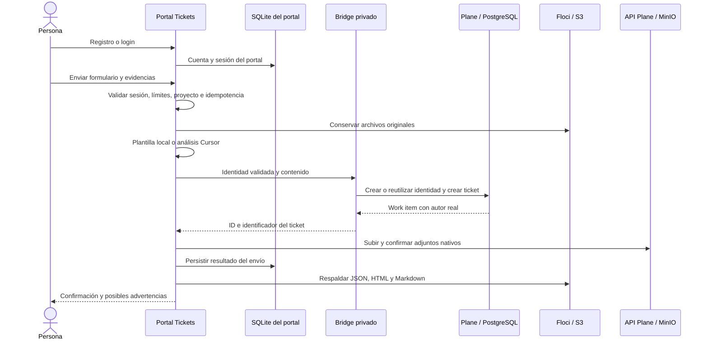
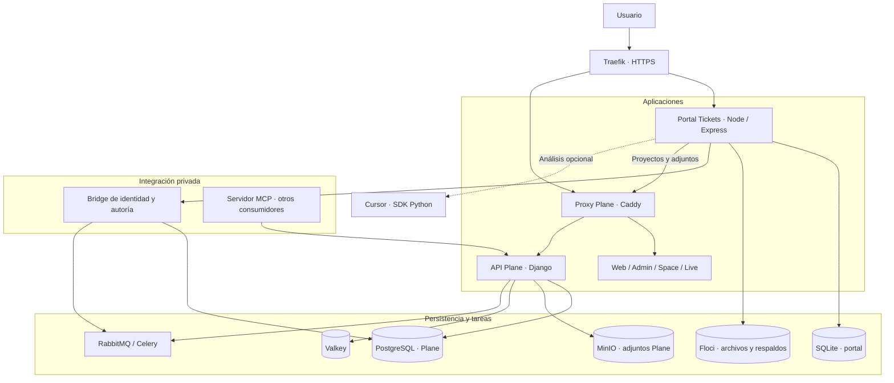

# Generador de Tickets Integrado

### Del reporte de una persona a un ticket de Plane con autoría real.

Portal de soporte para registrar **incidencias, mejoras y problemas de clientes**, adjuntar evidencias y convertir cada solicitud en un work item de Plane. Combina un formulario sencillo, identidad propia, análisis opcional con IA y almacenamiento persistente, en un stack Docker Compose preparado para operación local y despliegue con Dokploy.

**[Funcionamiento](#cómo-funciona) · [Arquitectura](#arquitectura) · [Inicio local](#inicio-local) · [Dokploy](#despliegue-en-dokploy) · [Pruebas](#pruebas) · [Contexto técnico](PROJECT_CONTEXT.md) · [Evolución prevista](PLAN_IDENTIDAD_EMPRESARIAL.md)**

> **Estado del proyecto:** el código actual incluye registro/login propios del portal y creación de tickets mediante un bridge privado de Plane. La integración con las cuentas empresariales, el inicio de sesión compartido y la sincronización de trabajadores están diseñados como evolución futura; todavía no están implementados. Este README describe el repositorio, no certifica el estado del VPS.

## Qué resuelve

Una persona puede reportar un problema sin conocer la estructura interna de Plane ni trabajar directamente en su interfaz. El equipo recibe un ticket con proyecto, prioridad, descripción estructurada y evidencias. El autor del work item es la identidad de la persona que reportó.

| Para quien reporta | Para el equipo de soporte |
|---|---|
| Registro e inicio de sesión en el portal | Ticket creado en el proyecto seleccionado |
| Tres tipos de solicitud: incidencia, mejora y problema de cliente | Título, prioridad y descripción HTML estructurada |
| Selección de proyectos consultados desde Plane | Autoría en `Created By` y actor de creación |
| Imágenes y PDF como evidencia | Adjuntos nativos de Plane y copia en almacenamiento S3 emulado |
| Confirmación con el identificador del ticket | Respaldo JSON, Markdown y HTML del envío |
| Reintentos con identificador de envío | Protección contra duplicación del work item |

El formulario recoge proyecto, tipo, título, prioridad, descripción, módulo/pantalla y pasos. El backend valida el contenido y confirma que el proyecto pertenece a la lista accesible para la integración.

## Cómo funciona

### 1. Registro y sesión

La persona crea su cuenta **en el portal Tickets**, con nombre, correo y contraseña. El portal guarda su cuenta en SQLite y utiliza scrypt con sal aleatoria para la contraseña. Registrarse o iniciar sesión no crea todavía un usuario Plane.

La sesión dura 12 horas y puede revocarse al cerrar sesión. La cookie es firmada, HttpOnly y SameSite=Lax; el Compose raíz usa Secure en producción y el entorno local se configura para HTTP.

### 2. Preparación del reporte

El portal consulta los proyectos de Plane con una API key de servicio y muestra sus nombres. La persona elige el destino, completa el formulario y puede añadir hasta **10 imágenes/PDF de 10 MiB cada uno**.

Los archivos se guardan en Floci. El backend prepara el contenido con una plantilla local o solicita un análisis opcional a Cursor mediante su SDK Python. La selección de proyecto se mantiene bajo control del backend; la IA no decide a qué proyecto enviar el ticket.

### 3. Identidad y creación en Plane

El backend envía la identidad de la sesión a un **bridge privado**. En el primer ticket, ese servicio crea la identidad Plane si no existe ya vinculada al usuario del portal. Utiliza nombre y correo, un username interno basado en el UUID del portal y una **contraseña inutilizable** mediante `set_unusable_password()`.

**La contraseña del portal nunca se copia a Plane.** Esa identidad permite atribuir tickets; no proporciona una contraseña para entrar a la interfaz Plane. Un correo que ya pertenece a otra cuenta Plane sin vínculo válido produce un conflicto que requiere revisión administrativa.

El bridge crea identidad, perfil, membresías y work item en una transacción PostgreSQL. Usa el serializer de la versión fijada de Plane y el contexto de auditoría del usuario para conservar su autoría. En los envíos siguientes reutiliza esa identidad.

### 4. Evidencias, respaldo y respuesta

Después de crear el work item, el portal carga los adjuntos nativos mediante la API de Plane y su almacenamiento MinIO. Guarda el resultado del envío y respalda sus representaciones JSON, HTML y Markdown en Floci. La respuesta muestra un identificador como `SUP-12`.

Los fallos individuales de adjuntos o respaldo pueden devolver un ticket creado con advertencias. La transacción de Plane no incluye los otros almacenes; sus límites se explican en [Garantías y límites](#garantías-y-límites).



## Arquitectura

El stack integrado contiene **17 servicios y 12 volúmenes nombrados**. Traefik recibe HTTPS en producción; Caddy conserva las rutas de Plane. El portal tiene su propio backend y un bridge sin exposición pública para las operaciones de identidad y autoría.



### Qué papel tiene cada pieza

| Pieza | Responsabilidad |
|---|---|
| **Portal Tickets** | Interfaz, cuentas propias, validación, archivos, análisis y coordinación del envío |
| **Bridge privado** | Identidad Plane, membresías y creación transaccional con autor real |
| **Plane** | Proyectos, work items, permisos, actividad e interfaz de gestión |
| **MCP de Plane** | Herramientas Plane por HTTP para otros consumidores; el envío actual del portal utiliza el bridge |
| **Floci** | Emulador S3 persistente para originales y copias del portal |
| **MinIO compatible** | Almacenamiento de los adjuntos nativos que muestra Plane |
| **Cursor** | Análisis opcional del reporte e imágenes; la aplicación también funciona con plantilla local |

**Floci y MinIO son almacenes distintos.** Una copia en Floci no equivale a un adjunto confirmado en Plane. Asimismo, la autoría humana del ticket y la credencial de servicio usada para cargar adjuntos son conceptos diferentes.

### Servicios y redes

| Grupo | Servicios Compose |
|---|---|
| Datos Plane | `plane-db`, `plane-redis`, `plane-mq`, `plane-minio` |
| Backend Plane | `migrator`, `api`, `worker`, `beat-worker` |
| Interfaz y entrada Plane | `web`, `space`, `admin`, `live`, `proxy` |
| Integración | `plane-mcp`, `plane-ticket-bridge`, `floci`, `floci-tickets` |

- **`tickets-net`**: red interna compartida por los componentes; no constituye aislamiento entre todos sus miembros.
- **`egress`**: salida de API y workers para integraciones.
- **`dokploy-network`**: red externa de producción, conectada a proxy, portal, API, web y admin. El override local la sustituye por una red propia.

El Compose de producción no publica puertos en el host. Los routers manuales principales apuntan a `proxy:80` y `floci-tickets:5179`. El bridge solo pertenece a la red interna y no debe recibir un dominio público. La exposición de MCP, si se necesita, debe verificarse en la configuración efectiva de Dokploy; su label habilitado no constituye por sí solo un router público completo.

## Tecnologías utilizadas

| Área | Tecnología |
|---|---|
| Interfaz del portal | HTML, CSS y JavaScript sin framework |
| Backend del portal | Node.js 22 en Docker, Express 4, Multer, `cookie-session` |
| Persistencia del portal | `node:sqlite`, SQLite con WAL y consultas parametrizadas |
| Credenciales y sesión | scrypt, tokens aleatorios, SHA-256 y cookies firmadas |
| Integración con Plane | Python, Django ORM, serializer Plane, `django-crum` y Gunicorn |
| Plataforma Plane | Django, PostgreSQL, Celery, RabbitMQ, Valkey y aplicaciones web de Plane |
| Cliente de objetos | AWS SDK for JavaScript, API S3 compatible |
| Archivos | Floci y MinIO compatible |
| Análisis opcional | Cursor Python SDK y proceso bridge local del SDK |
| Transporte MCP | MCP sobre HTTP, Starlette y Uvicorn sobre la imagen upstream fijada |
| Ejecución y despliegue | Docker Compose, Dokploy, Traefik y Caddy |
| Verificación | Node Test Runner, scripts Python/Node, Playwright y Chrome |

Las imágenes principales están fijadas por digest en Compose y Dockerfiles. Las dependencias Node se resuelven mediante `package-lock.json`. El bridge deriva del **mismo digest backend que API y migrator** porque utiliza sus interfaces Python internas.

Las fuentes incluidas declaran Plane 1.4.2 y Floci 2.3.0. El despliegue raíz utiliza imágenes ya construidas de ambos; sus manifiestos fuente no certifican por sí solos el contenido de esas imágenes.

## Estructura del repositorio

```text
.
├── README.md                         # Presentación y guía de entrada
├── PROJECT_CONTEXT.md                # Contexto técnico vigente y límites conocidos
├── PLAN_IDENTIDAD_EMPRESARIAL.md      # Diseño futuro, pendiente de implementación
├── .env.example                      # Configuración local de ejemplo
├── docker-compose.yml                # Stack integrado de producción
├── docker-compose.local.yml          # Override de desarrollo local
├── nuevo-ticket/
│   ├── server.js                     # API y coordinación del envío
│   ├── lib/                          # Auth, SQLite, Plane, adjuntos y análisis
│   ├── public/                       # Interfaz del portal
│   ├── scripts/                      # Cursor y utilidades de diagnóstico
│   └── test/                         # Pruebas unitarias del portal
├── plane-ticket-bridge/
│   ├── bridge.py                     # Identidad, membresías y autoría
│   └── Dockerfile                    # Backend Plane fijado + bridge
├── plane-mcp-server/                 # Adaptación HTTP del MCP upstream
├── tests/                            # Integración aislada y pruebas de navegador
├── plane/                            # Fuentes y documentación upstream de Plane
└── floci/                            # Fuentes y documentación upstream de Floci
```

El Compose raíz construye **portal, bridge y MCP**. Editar las carpetas fuente `plane/` o `floci/` no cambia las imágenes ejecutadas por este stack. Los Compose y scripts independientes que permanecen en subcarpetas corresponden a modos específicos o anteriores; la ruta principal es el Compose integrado de la raíz.

## Inicio local

### Requisitos

- Docker con contenedores Linux y Docker Compose compatible con los archivos del repositorio.
- Puertos locales **3000** y **5179** disponibles.
- Para ejecutar las pruebas Node desde el host: Node.js **22.13 o superior** y dependencias del portal instaladas.
- Para operar: workspace, proyectos y API key válidos de la instancia Plane que se vaya a utilizar.

Python y dependencias del análisis se instalan dentro de la imagen del portal. **Cursor no es necesario para el flujo con plantilla local.**

### 1. Preparar el entorno

Desde la raíz, en PowerShell, copiar el ejemplo únicamente si todavía no existe `.env`:

```powershell
if (-not (Test-Path -LiteralPath .env)) {
    Copy-Item -LiteralPath .env.example -Destination .env
}
```

Revisar `.env` antes del arranque. Si ya existen datos, conservar sus credenciales y el nombre de proyecto Compose. El ejemplo local usa `generador-tickets-integrado`, URLs HTTP y `SESSION_COOKIE_SECURE=false`. Sus secretos y token de bootstrap son de desarrollo.

### 2. Validar y levantar

```sh
docker compose -f docker-compose.yml -f docker-compose.local.yml config --quiet
docker compose -f docker-compose.yml -f docker-compose.local.yml up -d --build
docker compose -f docker-compose.yml -f docker-compose.local.yml ps -a
```

El primer arranque descarga imágenes, construye las propias y ejecuta migraciones. `migrator` debe terminar con código **0**; los otros servicios deben arrancar según sus dependencias y healthchecks.

| Aplicación | Dirección local |
|---|---|
| Portal Tickets | http://localhost:5179 |
| Plane | http://localhost:3000 |
| Configuración de instancia / God Mode | http://localhost:3000/god-mode/ |

El override publica esos puertos en `127.0.0.1`. MCP, bases y bridge permanecen sin puertos host publicados por ese override.

### 3. Preparar Plane en una instalación nueva

1. Completar el setup de instancia en God Mode.
2. Crear el workspace cuyo slug coincida con `PLANE_WORKSPACE_SLUG` y los proyectos de destino.
3. Emitir un token de integración en esa instancia Plane, con acceso a los proyectos y operaciones necesarias.
4. Sustituir `PLANE_MCP_API_KEY` en `.env` y aplicar la configuración del portal:

```sh
docker compose -f docker-compose.yml -f docker-compose.local.yml up -d floci-tickets
```

5. Registrarse en Tickets y enviar una solicitud controlada. Comprobar identificador, autoría y adjuntos en Plane.

`BOOTSTRAP_NOT_A_REAL_TOKEN` permite interpolar y arrancar servicios, pero **no sirve para consultar proyectos ni operar**. La instalación no tiene un aprovisionamiento de negocio totalmente automático. Las cuentas Plane existentes tampoco se importan al portal de forma automática.

## Configuración

La referencia de nombres y valores locales está en [.env.example](.env.example). El catálogo técnico ampliado está en [PROJECT_CONTEXT.md](PROJECT_CONTEXT.md#11-referencia-operativa-del-stack-actual).

| Variables | Función |
|---|---|
| `PLANE_DOMAIN`, `TICKETS_DOMAIN` | Hosts de producción para Plane y Tickets |
| `PLANE_WORKSPACE_SLUG` | Workspace único utilizado por el portal |
| `PLANE_MCP_API_KEY` | Credencial de servicio para proyectos y adjuntos; permanece en backend |
| `POSTGRES_PASSWORD`, `RABBITMQ_PASSWORD` | Credenciales de datos y cola |
| `AWS_ACCESS_KEY_ID`, `AWS_SECRET_ACCESS_KEY` raíz | Credenciales del almacenamiento Plane |
| `SECRET_KEY`, `LIVE_SERVER_SECRET_KEY` | Secretos de backend y colaboración Plane |
| `SESSION_SECRET` | Firma de sesión del portal; valor privado de al menos 32 caracteres |
| `TICKETS_BRIDGE_SECRET` | Secreto portal/bridge; si se omite, ambos usan `SESSION_SECRET` |
| `TICKETS_REGISTRATION_ENABLED` | `false` cierra nuevos registros del portal |
| `SESSION_COOKIE_SECURE`, `TICKETS_PUBLIC_URL` | Comportamiento de cookie según HTTP local o HTTPS público |
| `CURSOR_API_KEY`, `LLM_MODEL` | Análisis opcional; modelo por defecto `auto` |
| `FLOCI_BUCKET`, `FLOCI_AWS_*` | Almacenamiento del portal, separado de MinIO |

El Compose raíz configura las direcciones internas del portal: Plane mediante `http://proxy:80`, bridge mediante `http://plane-ticket-bridge:8220` y Floci mediante `http://floci:4566`. Entre contenedores, `localhost` se refiere al propio contenedor.

No incluir valores reales de `.env`, claves o cookies en issues, capturas o documentación. El código actual acepta defaults de desarrollo incluso en el Compose de producción: preparar valores propios es una responsabilidad de configuración que todavía no se impone por completo mediante validación.

## Despliegue en Dokploy

1. Configurar una aplicación de tipo **Docker Compose** con el repositorio y `./docker-compose.yml` raíz.
2. Usar exclusivamente ese archivo para producción, sin el override local ni `COMPOSE_FILE`/`COMPOSE_PROJECT_NAME` copiados del ejemplo de desarrollo.
3. Configurar dominios distintos para Plane y Tickets, DNS, secretos propios, workspace y token válido de Plane destino.
4. Verificar la red externa `dokploy-network` y la conexión de Traefik. Los labels asumen entrypoints `web`/`websecure` y resolver `letsencrypt`.
5. Conservar los routers manuales del YAML o adaptar deliberadamente el enrutamiento; no registrar los mismos hosts en Domains y en routers manuales simultáneamente.
6. Construir los servicios propios, revisar migraciones y comprobar el flujo completo con un ticket controlado.

Las URLs públicas se derivan de los dominios con HTTPS salvo overrides. La terminación TLS ocurre en Traefik. Los puertos internos principales son **80** para proxy y **5179** para Tickets.

Al actualizar una instalación existente, mantener la identidad del proyecto Compose, sus volúmenes y las credenciales con las que se inicializaron. **No usar `docker compose down -v` para desplegar una actualización.**

Un webhook de GitHub puede disparar redespliegues al hacer push según la configuración de Dokploy, incluso para documentación. Conviene revisar rama, commit y resultado real del despliegue. Una entrega aceptada del webhook no demuestra que el flujo de tickets haya quedado operativo.

## Persistencia y respaldos

| Volumen | Qué conserva |
|---|---|
| `tickets-users` | Cuentas, hashes, sesiones, límites y estado de envíos del portal SQLite |
| `pgdata` | Usuarios Plane, proyectos, membresías y work items |
| `uploads` | Adjuntos nativos de Plane en MinIO |
| `floci-data` | Archivos originales y respaldos del portal |
| `redisdata`, `rabbitmq_data` | Estado persistente de Valkey y RabbitMQ |
| `proxy_config`, `proxy_data` | Estado persistente del proxy |
| `logs_api`, `logs_worker`, `logs_beat-worker`, `logs_migrator` | Logs de backend Plane |

Un backup completo necesita **SQLite + PostgreSQL + ambos almacenes de archivos**, junto con la configuración privada necesaria para recuperarlos. Respaldar solo PostgreSQL no conserva las cuentas e idempotencia del portal.

SQLite usa WAL: copiar únicamente el archivo `.sqlite` mientras se escribe puede producir una copia inconsistente. Detener el portal para copiar o emplear un procedimiento de backup SQLite consistente. Los named volumes conservan datos al recrear contenedores; siguen necesitando backups y una restauración ensayada.

El almacenamiento SQLite actual presupone una sola instancia del portal con su volumen local. Varias réplicas con bases independientes no comparten sesiones ni resultados de envío.

## Garantías y límites

### Qué protege hoy

- **Autenticación del envío:** el autor se obtiene de la sesión, no de un campo libre del formulario.
- **Sesiones revocables:** cerrar sesión elimina el token guardado en servidor.
- **Idempotencia del work item:** UUID de envío, huella de campos/archivos, estado persistido y bloqueos transaccionales en PostgreSQL.
- **Conflictos de cuenta:** un correo Plane preexistente sin vínculo válido no se toma automáticamente.
- **Membresías suspendidas:** el bridge no las reactiva silenciosamente al recibir un ticket.
- **Creación atómica en Plane:** identidad, membresías y work item se crean dentro de la misma transacción.
- **Bridge privado:** Bearer compartido, sin publicación al host y con Traefik deshabilitado.

### Límites de uso implementados

| Operación | Límite de intentos |
|---|---|
| Registro | 10 por IP y 15 por correo en 15 minutos |
| Login | 50 por IP y 15 por correo en 15 minutos |
| Envío | 10 por usuario por ventana de 60 segundos; se comprueba antes de procesar adjuntos |

Los excesos responden `429`. Los intentos fallidos y reintentos también cuentan. La cabecera `X-Tickets-Request: 1` protege las mutaciones frente a formularios cross-origin, pero un cliente HTTP automatizado puede enviarla.

### Limitaciones conocidas

- Registro sin verificación de correo, recuperación de contraseña ni integración empresarial actual.
- Los proyectos visibles corresponden a la API key global; todavía no hay autorización individual de proyectos en el portal.
- El bridge asigna Guest en workspace y Member en cada proyecto al que se reporta. **Member es una membresía real de Plane**, no un permiso exclusivo de envío.
- No hay cuotas diarias ni control global de concurrencia. Los archivos se reciben en memoria y Cursor carece de un timeout global efectivo de aplicación.
- La garantía de no duplicación cubre el work item. Una caída a mitad de adjuntos puede requerir reconciliación; los respaldos/adjuntos fallidos no tienen una cola durable de recuperación.
- La actividad se publica después del commit; un fallo de RabbitMQ puede dejar el ticket creado sin todos sus eventos.
- El portal entrega confirmación de envío; no incluye historial ni seguimiento de solicitudes desde su interfaz.

El análisis detallado, sus evidencias y prioridades están en [el contexto vigente](PROJECT_CONTEXT.md#5-hallazgos-priorizados).

## Pruebas

### Pruebas unitarias del portal

Desde `nuevo-ticket/`, con Node compatible:

```sh
npm ci
npm test
```

Cubren cuentas y persistencia, hashes, validación, sesiones revocadas/expiradas, idempotencia almacenada, límites básicos y autenticación HTTP. No sustituyen la integración con Plane y archivos.

### Integración y navegador

Las pruebas completas utilizan un **stack aislado** llamado `tickets-portal-check`, definido combinando [docker-compose.yml](docker-compose.yml) con [tests/portal-compose.yml](tests/portal-compose.yml). No utilizar el overlay sobre producción ni sobre el proyecto con datos reales.

| Prueba | Cobertura |
|---|---|
| [seed_portal.py](tests/seed_portal.py) | Preparación de datos; requiere la guardia `PORTAL_TEST_SEED=tickets-portal-check` |
| [portal-e2e.mjs](tests/portal-e2e.mjs) | Registro independiente, identidad diferida, dos proyectos, adjuntos, reintentos y conflicto de cuenta |
| [bridge_checks.py](tests/bridge_checks.py) | Autenticación privada, concurrencia, suspensión y rollback |
| [portal-browser.cjs](tests/portal-browser.cjs) | Registro/login/logout, envío, respuesta perdida y reintento tras recarga |
| [plane-author-browser.cjs](tests/plane-author-browser.cjs) | Autoría visible en la interfaz oficial de Plane |

El entorno de pruebas usa Tickets en `127.0.0.1:15179` y Plane en `127.0.0.1:13079`. Playwright/Chrome se requieren para las pruebas de navegador; los scripts de integración necesitan los servicios y datos preparados. Los detalles de preparación y resultados históricos están en [PROJECT_CONTEXT.md](PROJECT_CONTEXT.md#11-referencia-operativa-del-stack-actual).

**Última verificación local documentada, 23 de octubre de 2026:** 4/4 pruebas unitarias correctas, sintaxis válida en 17 archivos JavaScript y 13 Python propios, y validación de ambos Compose. Las pruebas completas y de navegador del 22 de octubre están registradas como evidencia histórica del entorno aislado, no como validación actual de producción.

## Operación y diagnóstico

Para el entorno local integrado:

```sh
docker compose -f docker-compose.yml -f docker-compose.local.yml ps -a
docker compose -f docker-compose.yml -f docker-compose.local.yml logs --tail 100 migrator api
docker compose -f docker-compose.yml -f docker-compose.local.yml logs --tail 100 floci-tickets plane-ticket-bridge
```

| Comprobación | Qué demuestra |
|---|---|
| Portal `GET /api/live` | El proceso Node responde |
| Portal `GET /api/health` | El bucket es accesible; no valida el token Plane ni el flujo completo |
| Bridge `GET /healthz`, dentro de su red | El servicio puede consultar su DB |
| MCP `GET /healthz`, dentro de su red | El proceso MCP responde |
| Envío controlado y comprobación en Plane | Integración real de identidad, permisos, work item y adjuntos |

| Síntoma | Qué revisar |
|---|---|
| Sesión no persiste en local | URLs HTTP y `SESSION_COOKIE_SECURE=false` |
| No aparecen proyectos | Token emitido en la instancia correcta, slug y acceso API vía proxy |
| Conflicto al enviar con un correo existente | Vínculo de identidad; no cambiar contraseñas para forzar la asociación |
| Ticket creado con advertencia | Resultado de adjuntos y respaldo; revisar antes de repetir como envío nuevo |
| API no arranca | Migrator, PostgreSQL, Valkey y RabbitMQ |
| Plane responde 502 | Conectividad Caddy hacia web/API, DNS interno y redes efectivas |
| Análisis no termina | Proceso Cursor y sus límites de tiempo; hay una limitación conocida |

Los scripts antiguos de arranque independiente y `nuevo-ticket/scripts/e2e_check.py` no representan por completo el flujo actual. Para diagnóstico y pruebas del portal usar la ruta integrada y los scripts de `tests/` descritos arriba.

## Evolución prevista: identidad empresarial

El siguiente diseño propone que Tickets aproveche la cuenta y sesión de la página empresarial. Una persona normal enviaría solicitudes desde esa página. Si después se convierte en trabajador autorizado, conservaría **la misma identidad Plane y los mismos tickets**, y obtendría acceso de gestión a los proyectos asignados.

El inicio de sesión compartido requerirá comprobar la compatibilidad del sistema empresarial y la edición/configuración real de Plane. No consiste en copiar contraseñas ni en asociar automáticamente cuentas por correo. También incluye revocación del acceso al retirar la autorización laboral.

La arquitectura, los flujos, la migración y los criterios de aceptación están en [PLAN_IDENTIDAD_EMPRESARIAL.md](PLAN_IDENTIDAD_EMPRESARIAL.md). Es un plan pendiente; el registro propio del portal sigue siendo el funcionamiento actual.

## Documentación y componentes upstream

| Documento | Cuándo consultarlo |
|---|---|
| **[README.md](README.md)** | Entender el producto, recorrer la arquitectura y empezar a operarlo |
| **[PROJECT_CONTEXT.md](PROJECT_CONTEXT.md)** | Consultar el funcionamiento técnico completo, evidencia, restricciones y contexto de operación |
| **[PLAN_IDENTIDAD_EMPRESARIAL.md](PLAN_IDENTIDAD_EMPRESARIAL.md)** | Preparar la integración futura de cuentas empresariales y acceso a Plane |
| [Plane](plane/README.md) y [su licencia](plane/LICENSE.txt) | Fuentes y documentación de la plataforma de gestión |
| [Floci](floci/README.md) y [su licencia](floci/LICENSE) | Fuentes y documentación del emulador AWS |

Las licencias de los componentes upstream se conservan en sus directorios. Este repositorio no declara aquí una licencia global adicional para la integración propia.
